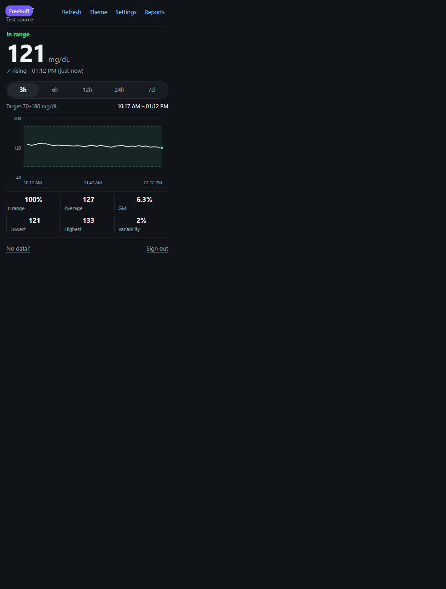
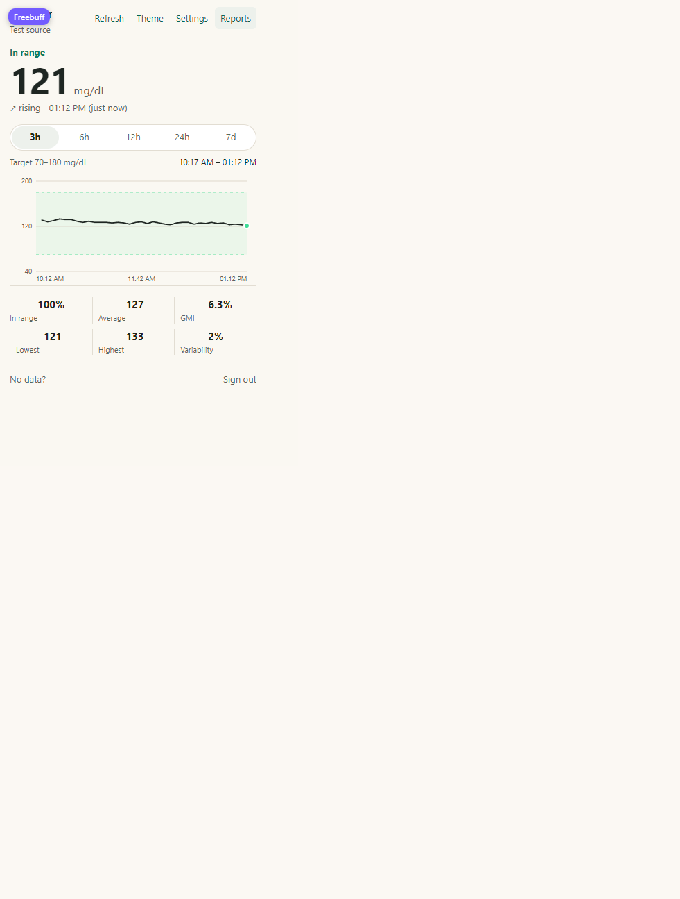
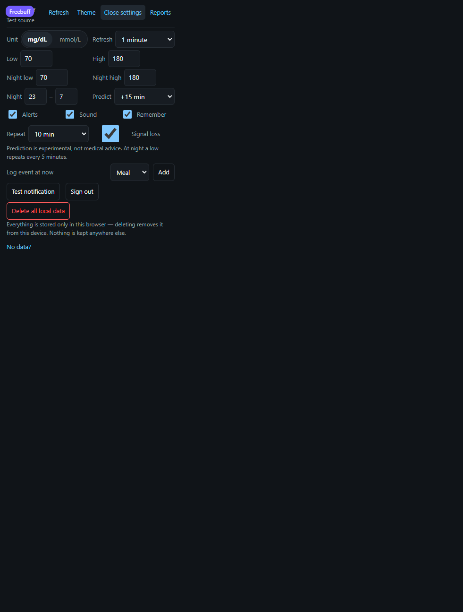
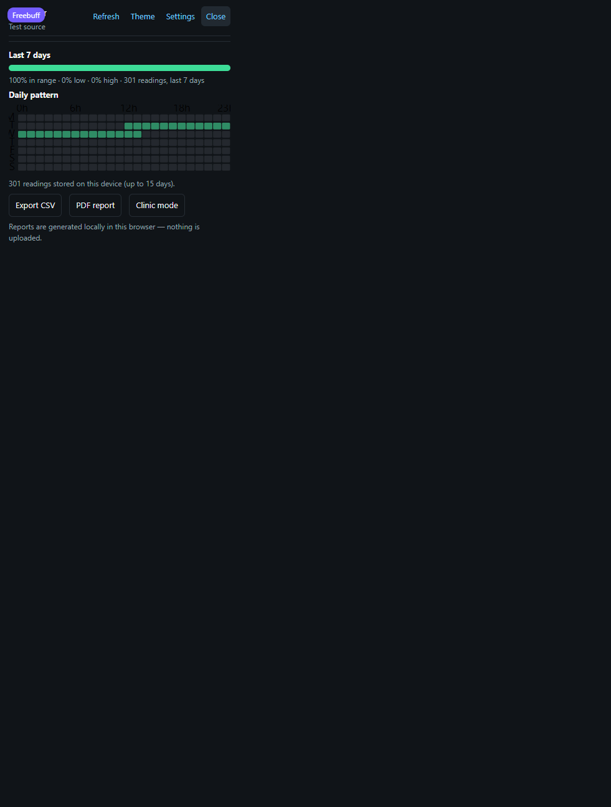
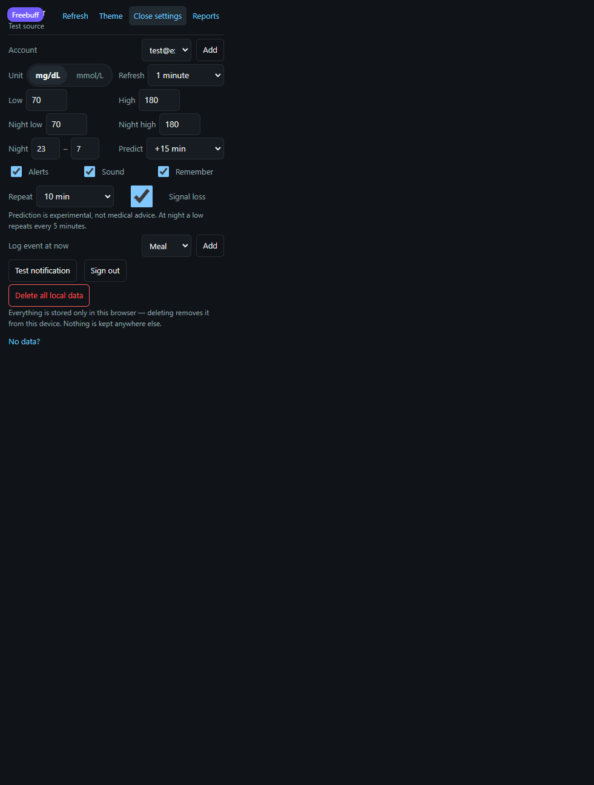
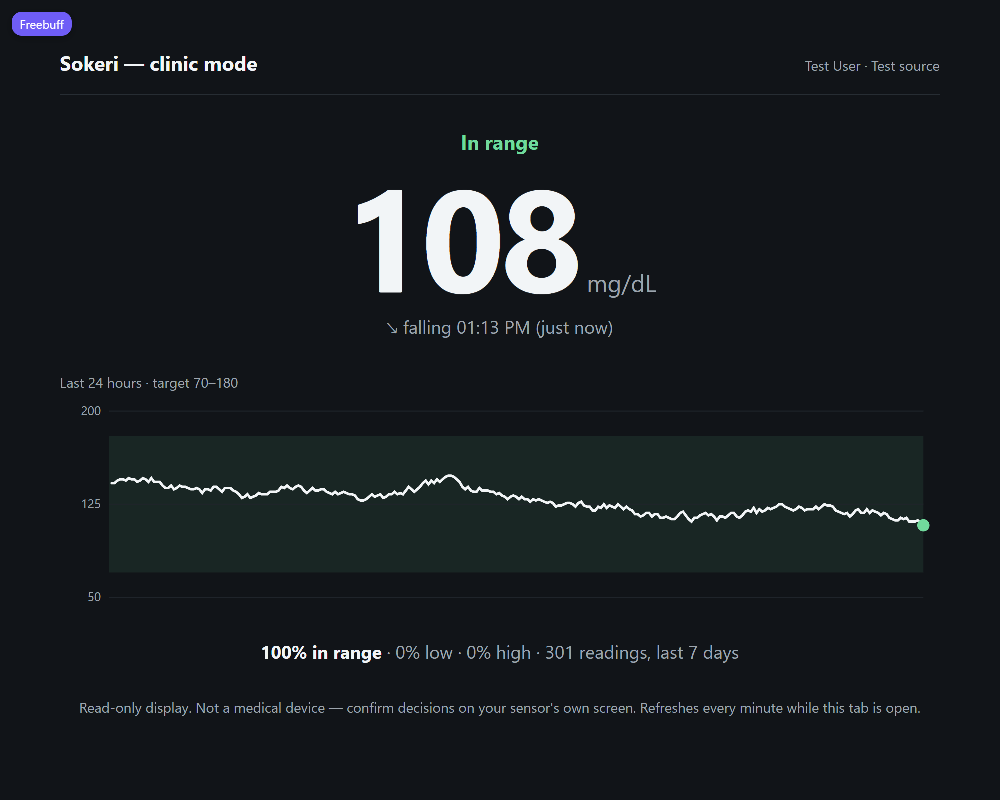

# Sokeri

Two Chrome extensions (Manifest V3) that track your glucose readings inside
the browser, plus the landing page that presents them.

**Repository:** https://github.com/ErdalBirinci/Sokeri  
**Live site (GitHub Pages):** https://erdalbirinci.github.io/Sokeri/

Fork it, adapt it, send improvements back — everything is here.

| Edition | Folder | Account | Sensors |
| --- | --- | --- | --- |
| Sokeri for FreeStyle Libre | `libre/` | LibreView | FreeStyle Libre |
| Sokeri for Dexcom | `dexcom/` | Dexcom Share | Dexcom G6 / G7 |

Both share the same panel: live value on the toolbar badge, trend arrow,
3/6/12/24-hour and 7-day charts, time-in-range stats (incl. GMI and
variability), high/low threshold alerts with snooze, repeat, night escalation
and a signal-loss watch, day/night thresholds and optional trend prediction
(drawn on the chart), a reports view (TIR bar, pattern heatmap, PDF report,
clinic mode), CSV export, event markers, mg/dL ↔ mmol/L conversion, and
light/dark themes. See `libre/README.md` and `dexcom/README.md` for the
edition manuals.

---

## Screenshots

Sample data. Dark theme, light theme, settings, reports, Dexcom multi-account
and the full-tab clinic mode:

| Dashboard (dark) | Dashboard (light) | Settings |
| --- | --- | --- |
|  |  |  |

| Reports (TIR, pattern, PDF, clinic) | Dexcom settings (multi-account) |
| --- | --- |
|  |  |



---

## Folders

```
sokeri-project/
├── libre/                   Libre edition (load this folder unpacked in Chrome)
│   ├── manifest.json
│   ├── background.js        service worker: sign-in, refresh, badge, alerts
│   ├── libreview.js         LibreView / LibreLinkUp API client
│   ├── popup/              sign-in + dashboard + settings + reports
│   ├── clinic/             full-tab clinic-mode display
│   ├── offscreen/          audio context for the threshold alerts
│   └── icons/              16/32/48/128 px icons (blue)
├── dexcom/                  Dexcom edition (load this folder unpacked in Chrome)
│   ├── manifest.json
│   ├── background.js
│   ├── dexcom.js            Dexcom Share API client
│   ├── popup/
│   ├── clinic/
│   ├── offscreen/
│   └── icons/              16/32/48/128 px icons (green)
├── site/                    landing page (English)
│   ├── index.html
│   ├── styles.css
│   ├── main.js
│   ├── validate-site.js
│   └── *.zip               packaged editions for download
└── tools/
    ├── validate.js          extension checks: node tools/validate.js
    └── generate-icons.js    icon painter: node tools/generate-icons.js [libre|dexcom]
```

---

## Privacy in one paragraph

The site (`site/`) collects nothing: no cookies, no analytics, no accounts,
no servers. Each extension stores your readings, settings and session **only
in your own browser** (`chrome.storage`) and talks **only** to your CGM
provider's servers (LibreView or Dexcom Share). Nothing is sent anywhere else.
You can erase everything at any time with the **Delete all local data**
button in the extension settings. Full details: the Privacy section on the
landing page.

---

## Important

Neither extension is a medical device, neither is intended for diagnosis or
treatment, and neither is affiliated with Abbott or Dexcom. For adults (18+)
as a convenience display only; always confirm critical decisions on your
sensor's own screen.
